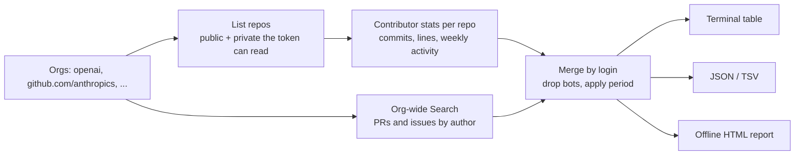

<p align="center">
  
  
</p>

[](https://github.com/luongnv89/devstats-cli/actions/workflows/ci.yml)
[](LICENSE)
[](https://www.rust-lang.org)

# Rank every contributor across your GitHub organizations

`devstats` scans every repository in one or more organizations and counts commits, lines,
pull requests, and issues per person. Results come out as a ranked terminal table, JSON, TSV,
or one offline HTML report.

[**Get started ->**](#quick-start)

## Why not script the API yourself

| Doing it yourself against the GitHub API | devstats |
|---|---|
| Contributor stats exist per repository only | Scans every repo in every org you name, merged by login |
| Stats are computed lazily; a cold repo answers `202 Accepted` | Retries while GitHub computes them |
| Search returns at most 1,000 results per query | Splits large date ranges automatically |
| Search allows 30 requests per minute | Waits out short rate-limit resets (up to 2 minutes) |
| 60 requests per hour without a token | Picks up `GITHUB_TOKEN`, `GH_TOKEN`, or `gh auth token` |
| Bot accounts inflate the ranking | `*[bot]` accounts dropped by default |

## How it works



API responses are cached for an hour per token, so re-sorting or re-rendering costs no API calls.

## Features

| Feature | What you get |
|---|---|
| Multi-org | Pass several orgs or users; contributors merge across all of them |
| Single repository | Pass `owner/repo` (or its URL) to rank who contributed to one project |
| PR breakdown | PRs opened per person, split into merged, still open, and closed without merging, overall and per week (`--pr-weeks`) |
| Private repos | Scanned when the token can read them; the report says when it can't |
| Time periods | `1y` by default; `all`, `6m`, `3m`, `1m`, `1w`, `1d`, or explicit dates |
| Terminal table | Share meter and 52-week braille activity graph; top value per column highlighted |
| HTML report | One offline file: KPI tiles, charts, sortable and searchable table, light/dark |
| Scriptable | `--format json` or `tsv`; plain TSV automatically when stdout is piped |
| GitHub Enterprise | Point `--api-url` at your server |

## Quick start

Install with Homebrew (macOS and Linux):

```bash
brew install luongnv89/tap/devstats
```

Or build from source (Rust 1.88 or newer):

```bash
cargo install --git https://github.com/luongnv89/devstats-cli
```

Log in once so devstats can use your token (skip if `GITHUB_TOKEN` is set):

```bash
gh auth login
```

Run it against an organization:

```bash
devstats https://github.com/openai
```

## Examples

Two real runs over the last 3 months, captured on 2026-11-18 in a 100-column terminal with a
token that isn't a member of either organization, so only public repositories were scanned.

### openai

```bash
devstats https://github.com/openai --period 3m --top 10
```

```text
╭─┐devstats · openai┌──────────────────────────────────────────────────────────────────────────────╮
│ 1 org   245 repos   16,421 contributors   10,413 commits   +13.33M / −2.64M lines                │
│ 8,252 PRs (6,223 merged)   19,366 issues                                                         │
╰─┘2026-11-18 · last 3 months (since 2026-08-18) · public repos only└──────────────────────────────╯
╭─┐contributors · top 10 by commits┌───────────────────────────────────────────────────────────────╮
│  #  contributor     commits  +lines  −lines    PRs  merged  issues  repos  share                 │
│  1  jbeckwith-oai     1,311   1.90M  321.0K  1,246   1,190       9     15  ■········· 13%        │
│  2  mldangelo-oai     1,240  824.0K  378.9K  1,240   1,150       1      2  ■········· 12%        │
│  3  jif-oai             560       0       0      1       0       0      1  ··········  5%        │
│  4  etraut-openai       539       0       0      0       0       0      1  ··········  5%        │
│  5  markstuart-oai      384  479.6K   86.2K  1,455   1,277      12     10  ··········  4%        │
│  6  seratch             319  202.2K   62.9K    238     231       0      4  ··········  3%        │
│  7  apcha-oai           267  965.3K  343.6K    276     254       0      6  ··········  3%        │
│  8  HAYDEN-OAI          265  104.8K   14.3K    204     194       1      8  ··········  3%        │
│  9  bc-openai           264       0       0      0       0       0      1  ··········  3%        │
│ 10  saioai              257  371.1K   21.0K    217     196       1      1  ··········  2%        │
╰─┘16,421 contributors · sorted by commits · --top 0 shows all└────────────────────────────────────╯
```

### anthropics

```bash
devstats https://github.com/anthropics --period 3m --top 10
```

```text
╭─┐devstats · anthropics┌──────────────────────────────────────────────────────────────────────────╮
│ 1 org   93 repos   20,929 contributors   3,089 commits   +30.91M / −328.7K lines                 │
│ 4,375 PRs (1,212 merged)   25,107 issues                                                         │
╰─┘2026-11-18 · last 3 months (since 2026-08-18) · public repos only└──────────────────────────────╯
╭─┐contributors · top 10 by commits┌───────────────────────────────────────────────────────────────╮
│  #  contributor        commits  +lines  −lines  PRs  merged  issues  repos  share                │
│  1  claude                 632  14.07M   54.5K    0       0       0     23  ■■········ 20%       │
│  2  actions-user           521   38.5K   11.6K    0       0       0      5  ■········· 17%       │
│  3  iainmcgin              246   98.0K   10.4K   37      35      60      2  ··········  8%       │
│  4  mhegazy                191   32.9K   38.4K  157     144       1      4  ··········  6%       │
│  5  fallintoplace          154   29.9K   2,596    0       0       0      1  ··········  5%       │
│  6  poteat                 105   48.0K   7,626   43      36       1      1  ··········  3%       │
│  7  ronleizrowice-ant      100   44.2K   6,694   99      81       0      1  ··········  3%       │
│  8  jordanecker-ant         70     895     778   82      71       0      3  ··········  2%       │
│  9  dtmeadows-ant           69   14.7K   1,693    1       1       0      9  ··········  2%       │
│ 10  UlisesGascon            53   4,784       1   52      52       1      1  ··········  2%       │
╰─┘20,929 contributors · sorted by commits · --top 0 shows all└────────────────────────────────────╯
```

### More runs

One repository: who contributed, with PRs merged, open, and closed, over the last 3 months:

```bash
devstats https://github.com/openai/codex --period 3m
```

Each contributor's pull requests week by week over the last 3 months:

```bash
devstats openai/codex --period 3m --pr-weeks
```

The same repository over an explicit window, ranked by pull requests:

```bash
devstats openai/codex --since 2026-01-01 --until 2026-06-30 --sort prs
```

Two orgs, top 10 by lines changed:

```bash
devstats https://github.com/openai https://github.com/anthropics --top 10 --sort lines
```

Last 6 months, plus an HTML report:

```bash
devstats anthropics --period 6m --html report.html
```

Everything, with no start date:

```bash
devstats anthropics --period all
```

An explicit date range:

```bash
devstats openai --since 2025-01-01 --until 2025-06-30
```

The top contributor as JSON:

```bash
devstats openai anthropics --format json | jq '.contributors[0]'
```

Every contributor as TSV:

```bash
devstats anthropics --format tsv --top 0 > contributors.tsv
```

## FAQ

**Why do some contributors show 0 lines?** GitHub reports 0 lines for repositories with
10,000 or more commits. Commits still count.

**Does it read private repositories?** Yes, when the token can read them. Otherwise the
report marks the org as `public repos only`. Token requirements are under Reference.

**Why is the first run slow?** GitHub computes contributor stats on demand, so a cold
repository can take a minute. Re-runs within the hour come from the cache.

## Get started

```bash
brew install luongnv89/tap/devstats
```

[**Options, token setup, and counting rules ->**](#reference) · Apache-2.0 licensed

## Reference

<details>
<summary>Install options</summary>

With Homebrew (macOS and Linux):

```bash
brew install luongnv89/tap/devstats
```

From source (Rust 1.88 or newer):

```bash
cargo install --git https://github.com/luongnv89/devstats-cli
```

Prebuilt binaries for Linux, macOS, and Windows are attached to each tagged GitHub release
(see `.github/workflows/release.yml`).

</details>

<details>
<summary>Options</summary>

Organizations can be given as `https://github.com/NAME`, `github.com/NAME`, or `NAME`.
A user account works too. To scan one repository, give `https://github.com/OWNER/REPO`
(any page of it, such as `/pulls` or `/tree/main`, works) or `OWNER/REPO`. A named
repository is scanned even if it is a fork or archived. A repository whose owner is also
given as a whole is counted once. An unknown name prints a warning and the others still run.

| Option | Default | What it does |
|---|---|---|
| `--html [PATH]` | `devstats-report.html` | Also write the HTML report. Put it after the orgs, or use `--html=PATH` |
| `-f, --format` | `table` | `table`, `json`, or `tsv` on stdout |
| `-s, --sort` | `commits` | `commits`, `additions`, `deletions`, `lines`, `prs`, `issues`, `repos` |
| `-n, --top N` | `25` | Show the top N contributors; `0` shows everyone |
| `-p, --period` | `1y` | Preset period ending today: `all`, `1y`, `6m`, `3m`, `1m`, `1w`, `1d` (see below) |
| `--since` / `--until` | | Limit to an explicit date range (`YYYY-MM-DD`) instead of a preset |
| `--include-forks` | off | Also scan forked repositories |
| `--exclude-archived` | off | Skip archived repositories |
| `--include-bots` | off | Keep `*[bot]` accounts |
| `--per-org` | off | Also print one table per organization |
| `--pr-weeks` | off | Also show each contributor's PRs per week (opened, merged, open, closed). In TSV, print one line per contributor and week instead |
| `-j, --jobs N` | `6` | Repositories fetched in parallel |
| `--token` | see below | GitHub token |
| `--api-url` | `https://api.github.com` | For GitHub Enterprise (or `DEVSTATS_API_URL`) |
| `--no-cache` | off | Skip the 1-hour response cache |
| `--no-color`, `-q`, `-v` | | No colors (also `NO_COLOR`), quiet, verbose API log |

</details>

<details>
<summary>Time period</summary>

By default devstats reports on the **last 1 year**. Before v0.2.0 the default was all time; pass `--period all` to get all-time totals. Pick another preset with `--period`:

| Preset | Range |
|---|---|
| `all` (or `all-time`) | everything, with no start date |
| `1y` | the last year (default) |
| `6m` | the last 6 months |
| `3m` | the last 3 months |
| `1m` | the last month |
| `1w` | the last week |
| `1d` | the last day |

A preset starts on the same calendar date one period ago (a month-end date clamps, so 6
months before Aug 31 is Feb 28) and ends today. `--since` and `--until` give an explicit
range instead and cannot be combined with `--period`. With only `--until`, the range has no
start date, as before. The period appears in the table header and the HTML report, and as
`range.period` / `range.period_label` in the JSON output. Commits and lines come in weekly
buckets, so `1w` and `1d` count every week that overlaps the period, while pull requests and
issues are counted by exact creation date.

</details>

<details>
<summary>Token</summary>

devstats looks for a token in this order: `--token`, `GITHUB_TOKEN`, `GH_TOKEN`, then
`gh auth token` (for github.com only). Without a token, GitHub allows only 60 requests per
hour. That's rarely enough, so run `gh auth login` or export `GITHUB_TOKEN`. Public
repositories need no scopes.

</details>

<details>
<summary>Private repositories</summary>

An organization's private repositories are scanned when the token can read them. That
needs one of:

- a classic token with the `repo` scope (the token `gh auth login` creates has it), or
- a fine-grained token whose resource owner is the organization, with access to the
  repositories and the **Metadata** repository permission (read). Pull requests and
  issues come from Search, which only returns items the token can read, so also grant
  **Pull requests** (read) and **Issues** (read). Without them, private PRs and issues
  are not counted.

If the organization uses SAML single sign-on, the token must also be authorized for it.

Without a token, or without access, only public repositories are scanned and the report
says so: the table footer reads `public repos only`, the JSON has
`orgs[].private_access` (`included`, `none_visible`, `no_token`, `listing_failed`,
`user_account`, or `repository` for a single named repository), and the HTML report shows it on each organization card and in the notes.
`none_visible` means the token saw no private repositories: GitHub's listing can't tell
"no access" from "no private repositories". If the full listing fails (for example SSO
not authorized), devstats warns and falls back to the public repositories. The private
count shows up in the repo totals (`totals.repos_private`).

For a user account, GitHub lists only public repositories, so only those are scanned.

</details>

<details>
<summary>Output formats</summary>

- **Terminal:** a summary box and a ranked table with a share meter and a 52-week braille
  activity graph. The highest value in each metric column is shown in bold cyan, and ties
  are all highlighted; `--no-color` and `NO_COLOR` turn this off with the other colors.
  Columns drop out on narrow terminals. The glyphs fall back to ASCII outside a UTF-8
  locale.
- **Piped, or `--format tsv`:** one contributor per line, tab-separated, with no header and
  no escape codes. The fields are `login, commits, additions, deletions, prs, prs_merged,
  issues, repos, orgs, prs_open, prs_closed` (`orgs` holds `owner/repo` for a repository
  target). With `--pr-weeks`, each line is one contributor and week instead:
  `login, week, prs, merged, open, closed`, only for weeks with at least one PR.
- **`--pr-weeks` in the terminal:** an extra box lists each shown contributor's weeks with
  PRs, oldest first, with a bar scaled to the busiest week.
- **`--format json`:** the full report: totals, per-organization breakdowns, the weekly
  series, the 52-week activity of each contributor, and their PRs per week
  (`contributors[].pr_weeks`: `week`, `prs`, `merged`, `open`, `closed`).
- **`--html`:** one offline HTML file with KPI tiles, ranked bars with a metric switch, code
  churn, the weekly commit timeline, organization cards, and a sortable, searchable
  contributor table. It has light and dark themes and prints cleanly.

</details>

<details>
<summary>Exit codes</summary>

| Code | Meaning |
|---|---|
| 0 | success |
| 1 | runtime error (network, API, rate limit exhausted, unwritable `--html` path) |
| 2 | usage error (unknown flag, bad value, `--since` after `--until`, `--period` with a date flag) |
| 3 | input error (invalid org, repository, or URL; none of them exist) |
| 130 | interrupted (Ctrl+C) |

</details>

<details>
<summary>Shell completions</summary>

Bash:

```bash
devstats --completions bash > ~/.local/share/bash-completion/completions/devstats
```

Zsh:

```bash
devstats --completions zsh  > "${fpath[1]}/_devstats"
```

Fish:

```bash
devstats --completions fish > ~/.config/fish/completions/devstats.fish
```

</details>

<details>
<summary>How the numbers are counted</summary>

- **Commits and lines** come from GitHub's contributor statistics
  (`/repos/{owner}/{repo}/stats/contributors`). They cover the default branch only, and only
  commits linked to a GitHub account. GitHub reports 0 lines for repositories with 10,000 or
  more commits. GitHub computes these stats lazily, so the first run on a cold repository
  can take a minute while devstats retries.
- **Pull requests and issues** come from one org-wide (or, for a repository target,
  repository-wide) Search query each, counted by author and creation date. Each PR is also
  split by its state today: merged, still open, or closed without merging. Per-week counts
  group PRs by the week they were opened (weeks start on Sunday, UTC, as in GitHub's
  stats), so the first and last week of a period can be partial. Search covers every repository the token can read, private ones included. Search returns at most 1,000 results per query, so devstats splits larger
  date ranges automatically. Search is also limited to 30 requests per minute, so large orgs
  can pause briefly.
- Contributors are merged by GitHub login across repositories and organizations. Bots are
  excluded by default.
- Repositories are the organization's public ones plus the private ones the token can read
  (see "Private repositories" above).
- Responses are cached for an hour in `~/.cache/devstats` (or `$XDG_CACHE_HOME/devstats`), so
  re-running with different `--sort`, `--top`, or `--html` options is instant. The cache is
  kept separately per token (keyed by a hash, never the token itself), so one token's private
  data is never served to another token or to a tokenless run.

</details>

<details>
<summary>Development</summary>

Unit tests and integration tests against a mock GitHub API:

```bash
cargo test
```

Lint:

```bash
cargo clippy --all-targets -- -D warnings
```

Format:

```bash
cargo fmt --all
```

</details>

## License

[Apache-2.0](LICENSE)
